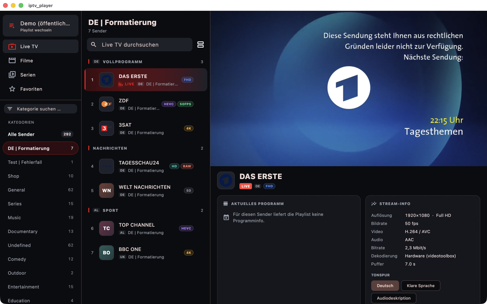

# IPTV Player

IPTV-Player für macOS und iOS mit Flutter, Riverpod und media_kit (libmpv).



## Funktionen

- Playlists per **Xtream Codes** (Server, Benutzer, Passwort) oder **M3U** (URL oder Datei)
- M3U-Parser im Hintergrund-Isolate, auch für sehr große Listen
- **Live TV** im 3-Spalten-Layout (macOS, iPad quer), Tab-Leiste mit Mini-Player auf dem iPhone
- Bereinigte Sendernamen mit Länder-Tag und farbigen Qualitäts-Badges (4K, HEVC, FHD …), Trennzeilen als haftende Abschnittsüberschriften
- **Filme und Serien** im Netflix-Stil: Titelbild, Kategorie-Reihen, Detailseite, Staffeln und Folgen
- Kurz-EPG, Stream-Info (Auflösung, FPS, Codecs, Bitrate) und Tonspurwahl
- Automatische Wiederholung bei Offline-Streams, Vollbild, Spulen, Favoriten

## Starten

```sh
flutter pub get
flutter run -d macos
```

Voraussetzungen: Flutter 3.47+, Xcode, CocoaPods (`brew install cocoapods`).

## Tests

```sh
flutter test                      # Unit-Tests (Parser, HLS-Auflöser, Namens-Bereinigung)

# Ende-zu-Ende mit echten öffentlichen Streams (macOS):
cd integration_test && python3 -m http.server 8765 --bind 127.0.0.1 &
flutter test integration_test/app_flow_test.dart -d macos
```

## Hinweis zu HLS

Das in media_kit mitgelieferte FFmpeg hängt bei HLS-Master-Playlists mit separaten
Ton-/Untertitelspuren (z. B. Das Erste). `lib/player/hls_resolver.dart` öffnet deshalb
direkt die beste Bildvariante und hängt die Tonspuren einzeln an.
