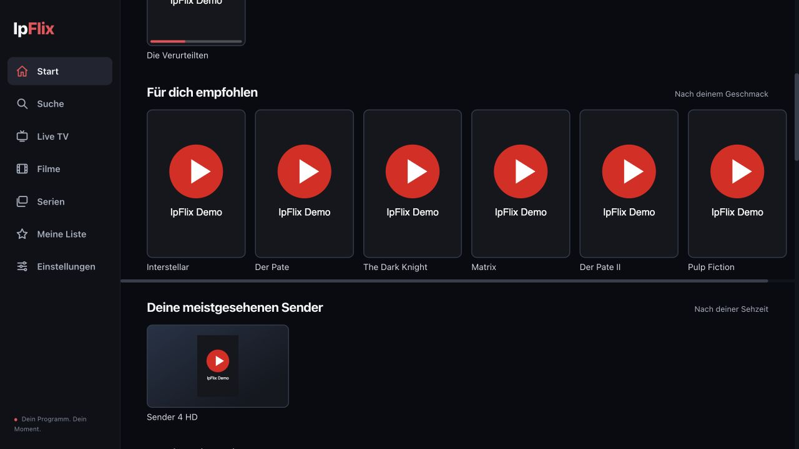
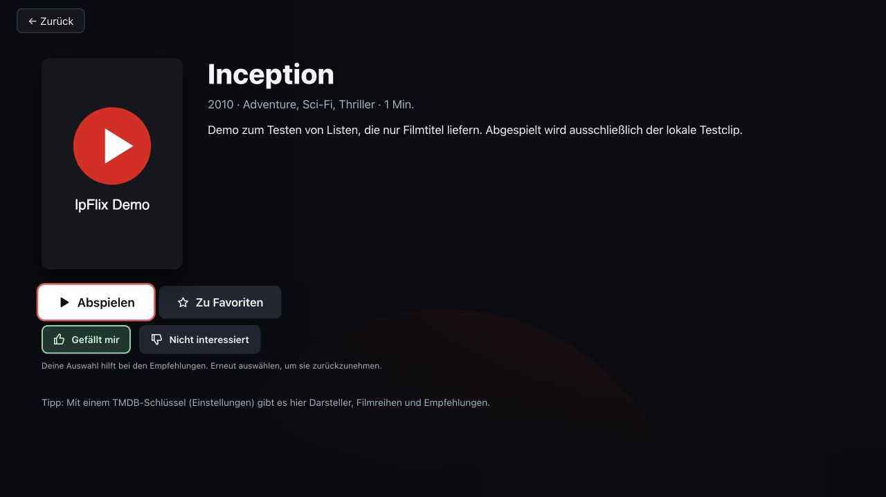

# IpFlix

Deine IPTV-Mediathek mit einer modernen Oberfläche für Filme, Serien und Live-TV.
IpFlix verbindet deine eigene **Xtream-Codes- oder M3U-Playlist** mit Suche,
persönlichen Empfehlungen und einem Player für Maus, Tastatur und Fernbedienung.
Das Projekt liefert selbst keine Fernsehsender, Filme oder IPTV-Abonnements.

**[Aktuelles Release](https://github.com/yazicienes19-ops/iptv-player/releases/latest)** ·
**[Alle Versionen](https://github.com/yazicienes19-ops/iptv-player/releases)** ·
**[Was ist neu?](CHANGELOG.md)** · **[Mitentwickeln](CONTRIBUTING.md)**



*Die Abbildung zeigt Testinhalte. Die Demofilme spielen ausschließlich einen Testclip ab.*

## Schnell ausprobieren

Für die lokale Browser-Vorschau brauchst du **Node.js 18 oder neuer** und **Python 3**.
Ein IPTV-Zugang ist zum Ausprobieren nicht erforderlich.

```sh
git clone https://github.com/yazicienes19-ops/iptv-player.git
cd iptv-player
node webos/dev/start.js
```

Öffne [http://127.0.0.1:47823/](http://127.0.0.1:47823/) und melde dich über **Xtream** an:

| Feld | Testwert |
|---|---|
| Server | `http://127.0.0.1:8766` |
| Benutzername | `test` |
| Passwort | `test` |

Der Startbefehl startet Oberfläche, lokalen Hilfsdienst und Demoanbieter zusammen.
**Pfeiltasten** navigieren, **Enter** bestätigt und **Escape** geht zurück. Maus und
Touchpad funktionieren ebenfalls. Mit **Strg+C** beendest du die Testdienste.

Ist `ffmpeg` installiert, wird einmalig ein lokales 90-Sekunden-Testvideo erzeugt.
Andernfalls verwenden Filme und Folgen ein freies Internet-Testvideo. Die
Live-Demos verwenden öffentliche HLS-Streams, deren Wiedergabe vom Browser abhängt.
Ein erfolgreicher MP4-Test bestätigt nicht automatisch HLS-, MKV- oder HEVC-Unterstützung.

## Das kann IpFlix

| Bereich | Funktionen |
|---|---|
| **Startseite** | Titelmotiv, Film- und Serienreihen, „Meine Liste“, „Für dich empfohlen“, neue Filme und persönliche Senderauswahl. Die Browser-/TV-Oberfläche bietet außerdem „Weiterschauen“. |
| **Empfehlungen** | „Gefällt mir“ und „Nicht interessiert“, Merkliste und tatsächliche Sehzeit beeinflussen die Vorschläge. Erneutes Auswählen nimmt eine Bewertung zurück. Nur verfügbare Titel deiner Playlist und Sprache werden vorgeschlagen. |
| **Suche** | Titel, Genres und vorhandene Angaben zu Besetzung und Regie; kleine Tippfehler werden toleriert. „Filme wie …“ findet ähnliche verfügbare Titel. |
| **Player** | Zurück-Pfeil, ±10 Sekunden, Zeitleiste, Pause, Vollbild, Bildschirmsperre, Lautstärke, Geschwindigkeit und Bildformat. Ton- und Untertitelwahl bei verfügbaren Spuren. |
| **Live-TV** | Senderkategorien, Länderfilter, Favoriten, Kurz-EPG bei Xtream und Wiederverbindung bei Streamfehlern. „Deine meistgesehenen Sender“ sortiert nach tatsächlicher Sehzeit, ab insgesamt 30 Sekunden. |
| **Filme und Serien** | Detailseiten, Staffeln und Folgen. „Neu in deiner Liste“ zeigt Zugänge der letzten 30 Tage – anhand des Anbieterdatums oder neuer Einträge nach dem ersten vollständigen Einlesen. |
| **Filminformationen** | Optionale TMDB-Details und ein persönlich importierter IMDb-Katalog für Bewertungen, Genres und Ranglisten innerhalb deiner eigenen Mediathek. |



Empfehlungen werden lokal berechnet. Pausen, Pufferung und Sprünge im Video zählen
nicht als Sehzeit. Ohne ausreichende Vorlieben gibt es zunächst eine als solche
gekennzeichnete Auswahl zum Entdecken. Bewertungen und Verlauf sind je Playlist
getrennt; eine Synchronisierung zwischen Geräten und mehrere Benutzerprofile
innerhalb derselben Playlist sind noch nicht vorhanden.

### Wenn die Playlist nur Filmtitel liefert

IpFlix bereinigt Länder-, Qualitäts- und Codec-Zusätze und kann eindeutige Titel
auch ohne Jahr oder Film-ID zuordnen. Der optionale lokale Katalog unterstützt
Originaltitel, deutsche/englische/türkische Alternativtitel und Schreibweisen wie
„Der Pate II“ beziehungsweise „Der Pate 2“.

Bei mehrdeutigen Neuverfilmungen oder unbekannten Titeln wird nichts geraten.
Diese Titel bleiben such- und abspielbar; für passende inhaltliche Empfehlungen
brauchen sie zusätzliche Metadaten. Die Abdeckung hängt vom importierten Katalog
und den Anbieterangaben ab. **Persönliche IMDb-Datensätze sind weder im Repository
noch in öffentlichen Release-Paketen enthalten.**

→ [IMDb-Katalog, Alternativtitel und Aktualisierung einrichten](docs/IMDB.md)

## Plattformen und Downloads

Die [Release-Seite](https://github.com/yazicienes19-ops/iptv-player/releases/latest)
führt die tatsächlich erzeugten Dateien und Hinweise der jeweiligen Version auf.
Ein gebautes Paket ist noch kein Nachweis, dass alle Geräte oder Medienformate funktionieren.

| Plattform | Aktueller Stand |
|---|---|
| **Browser** | Lokale Vorschau mit Node-Hilfsdienst vorhanden und geprüft. Kein allein durch Hochladen der HTML-Dateien betriebsfertiger Webdienst. |
| **macOS** | Native Flutter-App mit `media_kit`/libmpv. Automatisch erzeugte Pakete sind Test-Builds ohne Developer-ID-Signierung und Notarisierung. Hinweise und Teststand im jeweiligen Release beachten. |
| **LG / webOS** | Eigene TV-Oberfläche und IPK-Bauskript, auch für den vorhandenen webOS-4-Pfad. Neue Versionen müssen zusätzlich auf konkreten Geräten geprüft werden. |
| **Android / Android TV / Fire OS, iOS, Windows, Linux** | Projektgrundlagen vorhanden; keine pauschale Freigabe aller Geräte und Betriebssystemversionen. |
| **Samsung / Tizen, Roku, VIDAA, Fire TV mit Vega OS** | Eigene Plattformanbindungen noch nicht implementiert. |

Container, Video-/Audiocodec, Auflösung und Gerätehardware bestimmen gemeinsam,
ob ein Stream abspielbar ist. Der Hilfsdienst wandelt Videos nicht um. Browser-HLS
benötigt derzeit native Unterstützung; ein HLS.js-Fallback und ein DRM-Lizenzablauf
sind nicht eingebaut.

→ [Detaillierter Plattformstand, Mediengrenzen und offene Arbeiten](docs/PLATFORMS.md)

### Mac aus dem Quellcode starten

Benötigt werden **Flutter 3.47.8**, vollständiges **Xcode** mit macOS-SDK und **CocoaPods**.
Die Flutter-Version muss den in `pubspec.yaml` geforderten Dart-Stand unterstützen.

```sh
flutter pub get
flutter run -d macos
```

Für den Fernseher-Modus in der nativen App:

```sh
flutter run -d macos --dart-define=FORCE_TV=true
```

### LG-Paket selbst bauen

Mit installierter [webOS CLI](https://webostv.developer.lge.com/develop/tools/cli-introduction):

```sh
scripts/build_webos.sh
```

Das Paket liegt anschließend in `dist/`. Für Installation und Gerätetests müssen
der Entwicklermodus auf dem eigenen Fernseher und die CLI-Geräteverbindung eingerichtet sein.
Der persönliche IMDb-Katalog bleibt standardmäßig außerhalb des Pakets.

## Releases und Änderungshistorie

**Jede erfolgreich geprüfte Änderung auf `main` erzeugt automatisch ein neues Release.**
Lokale Dateispeicherungen und Änderungen auf Arbeitsbranches veröffentlichen noch
keine Version. Erst wenn die Änderungen auf `main` angekommen sind und die
vorgesehenen Prüfungen und Paket-Builds bestehen, wird veröffentlicht.

Jedes Release enthält eine Versionsnummer, eine Beschreibung der Änderungen und
Verweise auf den zugehörigen Quellcode. Ältere Tags, Releases und Downloads bleiben
erhalten. Ein erneuter Lauf für denselben bereits veröffentlichten Stand erzeugt
keine doppelte Version.

Für neue Beiträge wird eine kurze Änderungsnotiz unter `.changes/` ergänzt.
Diese Notizen fließen automatisch in das nächste Release ein und bleiben im
Repository erhalten. Das [Changelog](CHANGELOG.md) beschreibt zusätzlich größere
Versionsstände; sämtliche automatisch erzeugten Versionen stehen auf GitHub.

- [Aktuelle und ältere Veröffentlichungen](https://github.com/yazicienes19-ops/iptv-player/releases)
- [Lesbare Funktions- und Fehlerhistorie](CHANGELOG.md)
- [Technischer Ablauf, Versionsnummern und Wiederherstellung](docs/RELEASING.md)

## Daten und Sicherheit

Die beiden Oberflächen verwenden unterschiedliche lokale Speicher:

- **Native App:** Zugangsdaten, vollständige Favoriten und persönlicher Verlauf
  liegen im verschlüsselten System-Speicher. Der optionale VPN-Wächter mit
  Kill-Switch prüft erkannte Tunnel-Schnittstellen.
- **Browser-/LG-Oberfläche:** Einstellungen, Zugang und Verlauf liegen in
  `localStorage`. Die native Verschlüsselung und der native VPN-Wächter gelten
  hier nicht automatisch.
- Die native Löschfunktion entfernt die app-eigenen Daten und Caches. In der
  Browser-/TV-Oberfläche entfernt „Abmelden“ den lokalen Zugang und Verlauf.
- Testserver sind standardmäßig nur auf dem eigenen Rechner erreichbar. Der
  lokale Hilfsdienst ist nicht für einen ungeschützten öffentlichen Betrieb vorgesehen.

Für reale Playlists brauchst du einen eigenen Zugang. Keine Zugangsdaten, privaten
Playlist-Adressen oder API-Schlüssel in Issues, Pull Requests oder Screenshots veröffentlichen.

## Orientierung im Projekt

| Pfad | Inhalt |
|---|---|
| `lib/` | Native Flutter-Oberfläche, Player, Datenmodelle und lokale Speicherung |
| `webos/tv/` | Gemeinsame Browser-/LG-TV-Oberfläche |
| `webos/service/` | Lokaler Hilfsdienst und Verbindung zur TV-App |
| `webos/dev/` | Lokaler Startbefehl und Demoanbieter |
| `scripts/` | Paketbau, Metadatenimport und Release-Helfer |
| `test/`, `webos/test/` | Automatisierte Prüfungen beider Oberflächen |
| `integration_test/` | Tests mit laufender nativer App und Medien |
| `docs/` | Einrichtung, Plattformstand und Veröffentlichungen |
| `.github/` | Automatische Prüfungen, Releases und Vorlagen für Beiträge |

Zum Mitentwickeln: [CONTRIBUTING.md](CONTRIBUTING.md). Die ältere
[HANDOFF.md](HANDOFF.md) dokumentiert den damaligen Entwicklungsstand und ersetzt
nicht die aktuellen Installations- und Plattformhinweise.
